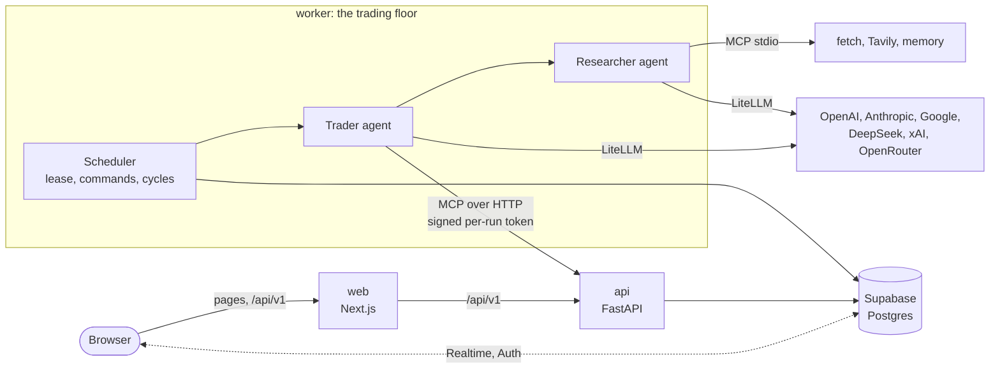

# Architecture

Gauntlet has three processes, one database and a browser app:

| Component | What it is | Code |
|---|---|---|
| **api** | FastAPI. Serves the dashboard's REST API (`/api/v1`) and hosts the two MCP servers the traders use (`/mcp/accounts/`, `/mcp/market/`). | `apps/api/src/gauntlet/api/`, `servers/` |
| **worker** | The trading floor: a scheduler that runs the trader agents. | `trading_floor.py`, `traders.py` |
| **web** | The Next.js dashboard. It forwards `/api/v1` to the API and renders every page per request. | `apps/web/` |
| **database** | Postgres (Supabase) in production, SQLite for development and the zero-setup demo. | `db/` |

The api and worker are the same Python package (`gauntlet`) and the same container image, started with different commands.



## The trading floor

`trading_floor.py` runs one loop, every `COMMAND_POLL_SECONDS` (5):

1. **Renew the leader lease.** Every scheduler process takes a lease on the `floor_state` row (`LEADER_LEASE_SECONDS`, 60), and only the holder acts. A process that newly takes the lease marks runs that a stopped process left "running" as failed (`Interrupted: ...`).
2. **Apply queued commands** from the `commands` table: `run_now`, `pause_trader`, `resume_trader`, `pause_floor` or `resume_floor`. The dashboard's admin panel and the CLI enqueue them.
3. **Start a cycle when one is due.** Every `RUN_EVERY_N_MINUTES` (60, or 3 in demo mode), unless the floor is paused. Cycles keep to fixed slots, so a long cycle doesn't push the next one later, and a cycle never starts while the previous one is still running.
4. **Touch the heartbeat file** (`HEARTBEAT_FILE`), which container health checks read through `python -m gauntlet.health`.

A cycle snapshots every active trader's portfolio, then runs all active traders concurrently. If the market is closed (and `RUN_EVEN_WHEN_MARKET_IS_CLOSED` is off), it skips the runs.

On SIGTERM, the loop is cancelled. In-flight runs are recorded as interrupted, and the lease is released, so a replacement process takes over at once.

## A trader run

`TraderRunner.run` in `traders.py` handles one run:

1. **Kind:** a run alternates between `trade` (look for new opportunities) and `rebalance`, based on the trader's last finished run.
2. **Record:** a row is inserted in `runs` with status `running`.
3. **Token:** a token is signed with `GAUNTLET_SECRET_KEY` that names the trader and the run, and expires after `MCP_TOKEN_TTL_SECONDS` (3 hours).
4. **Agent:** the trader agent (OpenAI Agents SDK) is built with:
   - **Instructions:** its persona and current strategy (`templates.py`).
   - **Account and market tools:** the accounts MCP server, and the market server (or Massive's own MCP server when `MASSIVE_API_KEY` is set), reached over streamable HTTP with the token.
   - **`Researcher`:** a second agent exposed as a tool, with three stdio MCP servers: fetch (web pages), Tavily (web search) and a libsql knowledge-graph memory kept per trader in `data/memory/<Name>.db`. In demo mode the researcher runs without these servers, and the demo model answers instead.
   - **`push`:** a function tool that sends a notification.
5. **Run:** the agent runs for up to 30 turns, within `RUN_TIMEOUT_SECONDS` (15 minutes). It ends with a structured summary: an appraisal, an outlook (`bullish`, `neutral` or `bearish`) and a confidence. OpenAI models return it as native structured output, and other providers return the same schema as JSON text.
6. **Retries:** a network error, rate limit or provider outage is retried with exponential backoff, up to `RUN_RETRIES` (2) times. A run that has already made a trade is never retried, so a retry can't trade twice.
7. **Finish:** the run's status, error, summary, tokens and estimated cost (from LiteLLM's price table) are saved, and the portfolio is snapshotted again.

Every span of the agent's trace (generations, tool calls, the researcher's work) is written to the `events` table by `tracers.py`. The dashboard's trace viewer reads it back as a tree.

### The tools an agent can use

| Server | Tool | What it does |
|---|---|---|
| accounts | `get_balance`, `get_holdings`, `get_account` | Cash; holdings as symbol → quantity; the full account report (valuation, P&L, strategy, limits, recent trades) |
| accounts | `buy_shares`, `sell_shares` | Place an order, with a rationale |
| accounts | `change_strategy` | Rewrite the trader's own strategy (versioned) |
| market | `lookup_share_price` | Current price of a symbol |
| (function) | `push` | Send a notification |
| (agent) | `Researcher` | Research a question using fetch, Tavily search and memory |

None of the account tools take an account argument. The account is the one named in the run's token, which `servers/auth.py` verifies on every request.

## The trading rules

`domain/accounts.py` (`AccountService`) is the only code that changes accounts. The MCP tools, the REST API and the CLI all call it.

- **Prices:** fetched before the transaction starts, so a slow price API never holds a lock.
- **Locking:** the trader row is locked (`SELECT ... FOR UPDATE`; on SQLite, `BEGIN IMMEDIATE`).
- **Checks:**
  - The quantity is a whole number between 1 and `MAX_ORDER_QUANTITY`.
  - The symbol is valid.
  - A buy must be covered by cash.
  - A sell can't exceed the shares held.
- **Prices paid:** buys pay the market price plus `SPREAD` (0.2%), and sells receive the market price minus it.
- **Guardrails:** buys are checked against the trader's limits (`domain/guardrails.py`):

  | Limit | Default |
  |---|---|
  | `max_position_pct` (a fraction of the portfolio) | 0.4 |
  | `max_positions` | 20 |
  | `max_order_value` | none |
  | `allowed_symbols` | none |
  | `denied_symbols` | none |
  | `trading_hours_only` | false |

  Sells are only subject to `trading_hours_only`. A rejected order is returned to the agent as a tool error and written to the activity log.
- **Accounting:** positions track average cost. Sells record realized P&L, and valuations compute unrealized P&L.
- **Bounds:** strategies are limited to 20,000 characters, rationales are cut at 4,000, and starting cash is at most $1,000,000,000.

## Data model

Alembic migrations in `db/migrations/versions/` own the schema, and a test fails if the models and migrations ever differ. Money columns are `Numeric(20, 6)` and are handled as `Decimal`. Timestamps are stored in UTC.

| Table | Holds |
|---|---|
| `traders` | Persona, model id, strategy, cash, starting cash, status (`active` or `paused`), guardrail overrides |
| `positions` | Symbol, quantity and average cost, per trader |
| `transactions` | Every trade: side, quantity, price paid, market price, realized P&L, rationale, run |
| `runs` | Kind, status, error, summary, outlook, confidence, tokens, cost, start and finish times |
| `strategy_versions` | Every version of every strategy, with its source (`seed`, `agent`, `admin`, `reset`) |
| `portfolio_snapshots` | Cash, holdings value and total value over time (for the charts and analytics) |
| `events` | The activity log and agent traces, with span ids for the trace tree |
| `commands` | Queued control commands and their outcome |
| `floor_state` | The pause flag, the leader lease and the last cycle time |

On Postgres, every table has row-level security. Migration 0003 lets Supabase's `anon` and `authenticated` roles read the dashboard tables, and adds those tables to the `supabase_realtime` publication. No role but the table owner (the backend) can write, and `commands` and `floor_state` aren't readable by browsers at all.

## The dashboard

`apps/web` is a Next.js 16 App Router app, in React 19 and TypeScript, styled with Tailwind CSS 4.

- **Data:** TanStack Query, with a typed client (`openapi-fetch`) generated from the API's OpenAPI schema (`openapi.json` → `src/lib/api-schema.d.ts`).
- **Live updates:** with Supabase configured, `src/lib/realtime.tsx` subscribes to row changes on the dashboard tables and refreshes the affected queries, and new trades appear as notifications. Without it, the queries poll every few seconds. The header shows "Live" or "Updating every few seconds".
- **Proxy and security headers:** `src/proxy.ts` forwards `/api/v1/*` to `API_URL`. It also gives every page a Content Security Policy with a per-request nonce.
- **Runtime configuration:** `API_URL`, `SUPABASE_URL` and `SUPABASE_ANON_KEY` are read on the server at request time. Nothing is baked into the build, so one image runs anywhere.
- **Charts:** lightweight-charts draws the equity curves (the portfolio against the same starting cash held in SPY), and inline SVG draws the sparklines, holdings strips and the arena's scatter plot.

## Security model

| Concern | How it's handled |
|---|---|
| An agent acting on another trader's account | Tools take no account argument; the account comes from a signed, expiring per-run token |
| An agent breaking its limits | Guardrails enforced in the same transaction as the trade |
| Lost or double trades | Row locks; retries only before a run has traded |
| Admin access | A Supabase JWT (JWKS-verified, `ADMIN_EMAILS` allowlist) or `ADMIN_API_TOKEN`; closed if neither is configured |
| Token guessing | Rate limits on admin actions, and a lockout after `ADMIN_AUTH_FAILURE_LIMIT` failed sign-ins per address |
| Browser data access | Read-only RLS policies on dashboard tables; the API is the only writer |
| Injected scripts | Nonce-based CSP, `frame-ancestors 'none'`, `nosniff`, a referrer policy and a permissions policy |
| MCP DNS rebinding | The MCP servers only accept the hosts in `MCP_ALLOWED_HOSTS` |
| Supply chain | Pinned and locked dependencies; MCP tools installed at pinned versions at build time; digests and SHAs for images and Actions |
| Runtime | Non-root, read-only containers; NetworkPolicies; Sealed Secrets |

The full rationale for each of these choices is in the [architecture decision records](adr/README.md).

## Folder structure

```
Gauntlet/
├── apps/
│   ├── api/                          The Python package `gauntlet` (uv workspace member)
│   │   ├── pyproject.toml
│   │   └── src/gauntlet/
│   │       ├── api/                  FastAPI app: create_app, /api/v1 routes (v1.py),
│   │       │                         response schemas (schemas.py), admin auth (auth.py)
│   │       ├── db/                   SQLAlchemy models, engine, money/time types, Alembic migrations
│   │       ├── domain/               AccountService, guardrails, floor control, analytics, errors
│   │       ├── market/               Price providers: simulator, Massive (cached); NYSE calendar
│   │       ├── servers/              MCP servers (accounts, market) and their token middleware
│   │       ├── trading_floor.py      The scheduler (python -m gauntlet.trading_floor)
│   │       ├── traders.py            TraderRunner: one agent run
│   │       ├── llm.py                Model catalog, provider routing, cost estimates
│   │       ├── demo.py               The scripted demo model
│   │       ├── templates.py          Prompts; personas.py: the four starting traders
│   │       ├── mcp_servers.py        Which MCP servers each agent connects to
│   │       ├── mcp_tools.py          Pinned third-party MCP servers, and their installer
│   │       ├── tracers.py            Agent traces → the events table
│   │       ├── notify.py             Pushover, ntfy, Slack or the log
│   │       ├── security.py           Signing and verifying per-run tokens
│   │       ├── settings.py           Every setting, typed
│   │       ├── container.py          Wires the services together
│   │       ├── health.py             The worker's health check
│   │       ├── legacy_import.py      Imports the original project's accounts.db
│   │       └── cli.py                The `gauntlet` command
│   └── web/                          The Next.js dashboard
│       ├── src/app/                  Pages: / (floor), /traders/[slug], /arena, /admin, /healthz
│       ├── src/components/           Floor, trader, admin, chart and UI components
│       ├── src/lib/                  API client and types, queries, auth, Realtime, formatting
│       ├── src/proxy.ts              /api/v1 forwarding and the Content Security Policy
│       ├── e2e/                      Playwright tests
│       └── openapi.json              The API schema the client types are generated from
├── tests/                            The Python test suite (pytest)
├── deploy/
│   ├── docker/                       api.Dockerfile, web.Dockerfile
│   ├── helm/gauntlet/               The Helm chart, values-local.yaml, values-prod.yaml
│   ├── argocd/                       root.yaml and the app-of-apps chart (apps/)
│   └── scripts/                      cluster-up/down, bootstrap-argocd, seal-secrets
├── docs/                             This documentation, and the ADRs in docs/adr/
├── supabase/config.toml              The local Supabase stack (npx supabase start)
├── .github/                          CI, release and security workflows; Dependabot
├── docker-compose.yml                The whole stack in containers
├── pyproject.toml, uv.lock           The uv workspace, dev tools and their config
├── .env.example                      Every common setting, documented
└── Makefile                          Shortcuts (make up, make test, make cluster-up, ...)
```

`data/` (git-ignored) holds the SQLite database and the researchers' memory when running locally.
